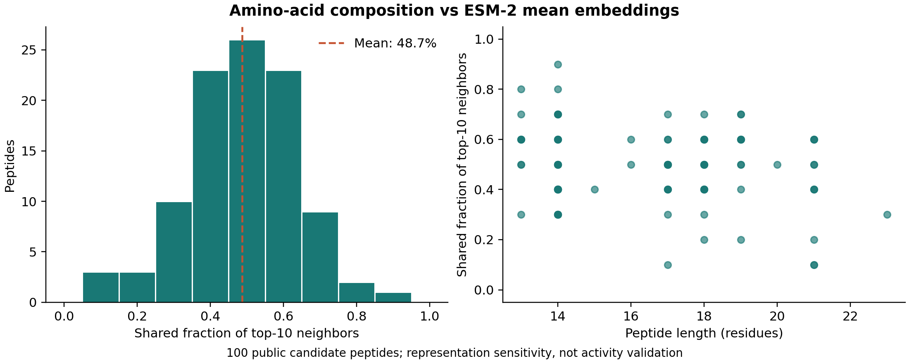

# Moved to bio-evidence

This tool is maintained as [`bio_evidence.embedding_drift`](https://github.com/aarnavbhat23/bio-evidence/blob/main/src/bio_evidence/embedding_drift.py) in [bio-evidence](https://github.com/aarnavbhat23/bio-evidence). The package has one API, one test suite and worked public-data cases.

This repository is archived to keep prior commits and results inspectable. Its original standalone documentation is below.

---

# Protein Neighbor Drift

Measure which sequence neighborhoods change between two protein embedding representations.

**Status: working research prototype.** The bundled input is a synthetic fixture for exercising code. Its report is not evidence about real biological data or real model performance.

## Try it

Python 3.13 was used for local validation. From this repository:

```bash
python3 -m venv .venv
source .venv/bin/activate
python -m pip install -r requirements.txt
python tool.py examples/input.json --output report.json
python -m unittest discover -s tests -v
```

See [`examples/input.json`](examples/input.json) for a complete input and [`examples/report.json`](examples/report.json) for the actual output from that fixture. [`docs/SCHEMA.md`](docs/SCHEMA.md) describes the fields and interpretation. The report records the input SHA-256. No API key is needed for this demo.

## Contribution and related work

Per-sequence neighbor turnover plus within-family retrieval under representation changes.

Protein representation comparisons and homology retrieval already exist; this MVP offers a compact paired-input diagnostic. Related primary source: [https://github.com/tsenoner/plm_choice](https://github.com/tsenoner/plm_choice). The related-work scan is preliminary; no claim of being the first implementation is made.

## Next experiment

Run the included pinned ESM-2 encoder; compare pooling or checkpoints on a licensed dataset with family labels and bootstrap uncertainty.

This milestone is planned, not completed. Preregister splits, metrics and exclusions before inspecting test results. Preserve source licenses and version identifiers when adding external data.

## Why this project

Protein-model teams, including Profluent; tool fit is not an internship endorsement. This describes technical relevance, not company affiliation, a hiring prediction or a claim that the company requested the tool.

## Validation

The initial local run passed 8 regression tests and the documented CLI example. CI repeats the core tests and example on Python 3.13. Network/model inference is not run in CI.

## Limitations and authorship

See the schema notes for method-specific limitations. This software has not been independently validated by researchers and does not establish experimental activity, clinical usefulness or model superiority.

Initial implementation and toy fixtures were generated with Codex. Maintainer: Aarnav Bhat. Real-data studies and human review remain future work unless a separately documented result explicitly says otherwise. Code and original synthetic fixtures are MIT licensed; externally sourced datasets and model weights retain their own licenses.

## Contributing

Useful contributions include a small reproducible failure case, an independently reviewed dataset adapter, or a metric correction. Include the input schema, expected behavior and source provenance. Avoid committing personal data, credentials, model caches or data without redistribution rights.

## Actual pretrained-model run

See [the ESM guide](docs/ESM.md) and [run report](results/esm-public-atlas/report.json) for the included 100-candidate CPU comparison. Optional dependencies are separate.


